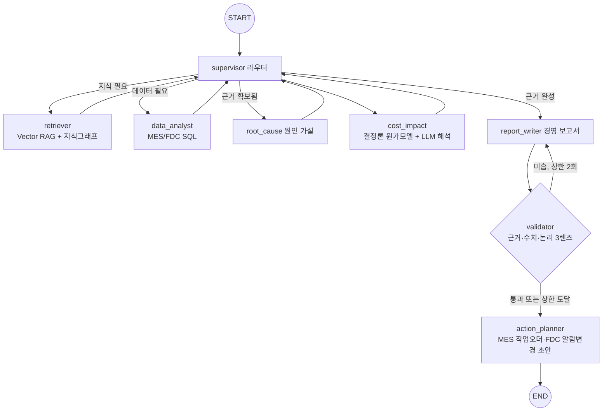

# hw-fabops — 제조 현장 이슈 대응 멀티에이전트

엔지니어가 설비 이슈를 만났을 때 하는 업무 사이클 — SOP·과거 이슈 조사, MES/FDC
데이터 조회, 원인 가설, 손실 정량화, 보고서 작성, 셀프 리뷰 — 를 LangGraph
멀티에이전트가 End-to-End 로 대신한다. 반나절에서 이틀 걸리던 이슈 대응 업무를
몇 분으로 줄이는 현장 업무 자동화가 목표이며, 산출물은 근거가 추적 가능한
분석 결과와 결재 가능한 수준의 보고서 초안이다.

## 배경

HW AI Translation(실시간 회의 통역 서비스)에 이어지는 개인 프로젝트 라인이다.
ERP 컨설팅 업무를 자동화하려고 Claude Code 기반 멀티에이전트 시스템(기획→구현→
검증→오케스트레이션 파이프라인, 전문 에이전트 20여 종)을 만들어 운영해 왔다.
이 프로젝트는 그 오케스트레이션 설계를 LangGraph 로 이식하면서, 컨설팅에서 다루던
질문 — "기술 이슈가 결국 돈으로 얼마인가, 무엇부터 고쳐야 하는가" — 을 제조 도메인에
적용한 실험이다.

대부분의 LLM 에이전트 데모는 "지식 Q&A"에서 멈춘다. 이 프로젝트는 엔지니어 업무의
나머지 절반 — 원인 규명 다음의 손실 정량화(원), 개선 ROI 비교, 보고 문서화 — 까지
자동화한다. 보고서 생성은 경영진용 기능이 아니라, 엔지니어가 가장 시간을 뺏기는
마지막 업무(기술 이슈의 비즈니스 언어 번역)를 대신하는 것이다.

업계 분류로는 Industrial Agentic AI 의 human-in-the-loop 단계에 해당한다 — 분석과
조치 초안까지 자동화하되, 실행(발행)은 사람의 승인에 남긴다.

차별화 3축
1. 비즈니스 밸류 브릿지 — 원인 → 수율손실 → 원가(₩) → 개선안 ROI. 산술은 LLM이 아닌
   결정론적 Python 모델이 계산하고(LLM은 곱셈을 틀린다), LLM은 해석·개선안만 담당.
   해석가능한 결정론 기법과 LLM을 결합하는 이 구성은 FDC 분야의 최신 하이브리드
   아키텍처 연구 방향과 같다
2. 자가개선 순환 루프 — validator가 기준 분리 루브릭(LLM-as-judge: 근거정합성·수치
   정확성·논리구조)으로 채점 후 미흡하면 재작성으로 되돌리는 cyclic graph.
   검증 불능 시 자동 통과가 아니라 한계를 명시(fail-visible)
3. 온톨로지 가이드 하이브리드 검색 — 벡터 유사도가 못 보는 다단계 인과
   (설비→파라미터→메커니즘→계측→원가)를 도메인 온톨로지 경로 탐색으로 보강

## 아키텍처



지식그래프 경로 예시 (온톨로지 기반, `data/ontology.json`):

```
RTP-01 --관리파라미터--> peak_temp_C --상승시유발--> 도펀트 과확산 --변동시킴--> sheet_res_ohm
peak_temp_C --점검항목--> 파이로미터 캘리브레이션
```

## 실행

```bash
python -m venv .venv && source .venv/Scripts/activate   # Windows Git Bash
pip install -r requirements.txt
cp .env.example .env        # GOOGLE_API_KEY 입력
python data/seed_db.py      # MES/FDC 시뮬레이션 DB 생성
python data/build_index.py  # RAG 인덱스 구축
python -m unittest discover -s tests   # LLM 무의존 단위테스트 18개
python -m src.graph "M15 RTP 설비 최근 2주 수율 하락 원인과 재무 영향, 개선 우선순위 알려줘"
uvicorn api:app --port 8796 # 콘솔 UI + API (http://localhost:8796, ?mock 로 목데이터 모드)
```

시나리오 주입 (Fab Data Gateway) — 데모 중 새 이상 상황을 실시간으로 만들 수 있다:

```bash
curl -X POST localhost:8796/api/scenario \
  -H "Content-Type: application/json" \
  -d '{"equip_id":"IMP-02","yield_drop_pp":8.0,"days":6}'   # 이온주입 설비에 이상 주입
curl -X POST localhost:8796/api/scenario/reset               # 기준 데이터 복원
```

주입 후 콘솔에서 "IMP-02 수율 이슈 분석해줘"를 실행하면 분석기가 새 시나리오를
스스로 찾아낸다 — 답을 미리 심어둔 데모가 아니라는 것을 이 게이트웨이로 증명한다.

## 기술 스택

Python · LangGraph(StateGraph, conditional edge, cycle, InMemorySaver) · LangChain ·
Gemini(langchain-google-genai) · Chroma(Vector DB) · SQLite(MES/FDC 시뮬레이션) ·
순수 Python 지식그래프 · FastAPI(콘솔 UI + API) · Streamlit(개발용)

## 한계와 가정 (정직한 스케일)

- 데이터는 합성이다. 현장 데이터 접근이 불가하므로 공개 공정 지식을 바탕으로 인과가
  일관된 시뮬레이션 환경(SOP corpus + MES/FDC 로그 + 원가 마스터)을 직접 설계했다.
- 온톨로지는 사람이 정의한 경량 인과 골격(23 엔티티)이다. GraphRAG 풀 구현이 아니라
  온톨로지 가이드 하이브리드 검색이다 — 무거운 커뮤니티 요약형 GraphRAG 대신 경량
  그래프를 택하는 것은 최근 업계 방향(LightRAG·LazyGraphRAG 등 저비용 그래프)과 같다.
- 원가 모델은 전량 스크랩 가정의 보수적 추정이며 가정을 assumptions 로 함께 반환한다.
  이상 판정은 SPC 3σ 준용 유의성 게이트를 거친다 — 정상 변동을 이상으로 오인하면
  불필요한 PM·라인 정지로 이어지므로, 판정 근거(σ 배수)를 산식과 함께 노출한다.
- 실서비스 전제: 공정 데이터의 사외 반출 금지 요건상 LLM 은 사내 프라이빗 엔드포인트
  (온프레미스/전용 VPC)를 전제로 한다. 데모는 공용 API 로 대체하며, LangChain 추상화로
  엔드포인트 교체는 llm.py 한 파일 수정이다.
- 모든 분석 실행은 감사 이력(audit_runs — 실행 ID·질의·결론·검증 결과·모델·소요시간)으로
  서버에 남고, 콘솔의 Raw 데이터 브라우저에서 조회할 수 있다.

## 로드맵 (다음 단계 설계)

| 단계 | 내용 |
|---|---|
| 승인 게이트 고도화 | 조치 발행 전 LangGraph interrupt 기반 승인 단계 — checkpointer(thread_id)로 정지·수정·재개 |
| 도메인 특화 | 공정 용어·이슈 패턴 corpus 축적 후 경량 모델 Fine-tuning (현재는 RAG 대체) |
| 지식그래프 확장 | LLM-augmented KG(문서에서 엔티티·관계 자동 추출) + 그래프 DB 이관 |
| 관측성 | OpenTelemetry(gen-ai 시맨틱 컨벤션) 기반 노드별 트레이스 — 토큰·지연·품질 모니터링 |
| Legacy 실연동 | SQLite 시뮬레이션 자리에 실제 MES/FDC/SAP 커넥터(OData) 대체 |
| 커넥터 표준화 | MES 작업오더·FDC 알람 커넥터를 MCP(Model Context Protocol) 서버로 노출 — 에이전트 표준 프로토콜 접근 |
| 판단 규칙화 | 원가모델을 룰 엔진으로 일반화, validator 루브릭에 규칙 기반 검증 추가 |

## 라이선스·데이터 주의

모든 데이터(SOP 문서, 설비 로그, 원가)는 공개 지식 기반으로 직접 설계한 합성물이다.
특정 회사의 실데이터·내부 정보를 포함하지 않는다.
